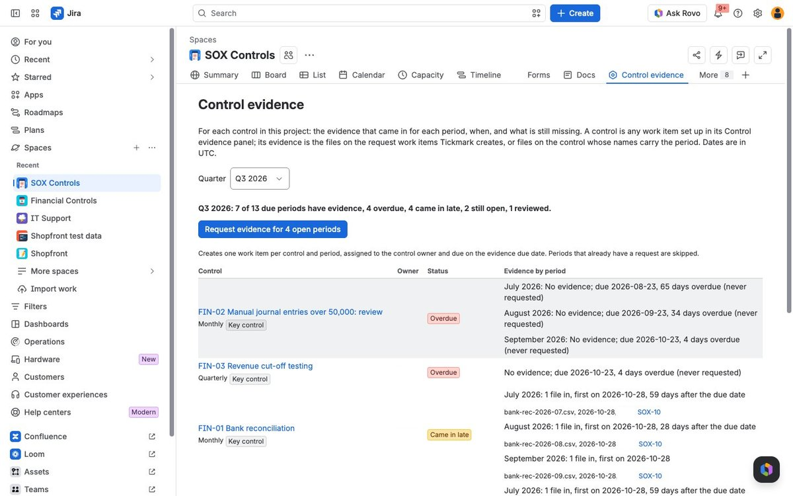
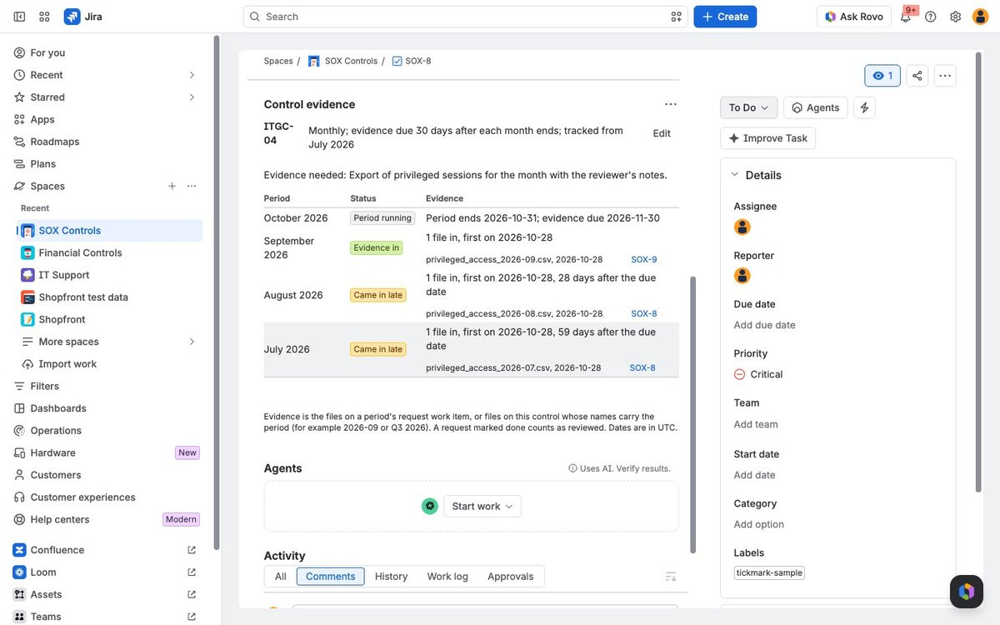
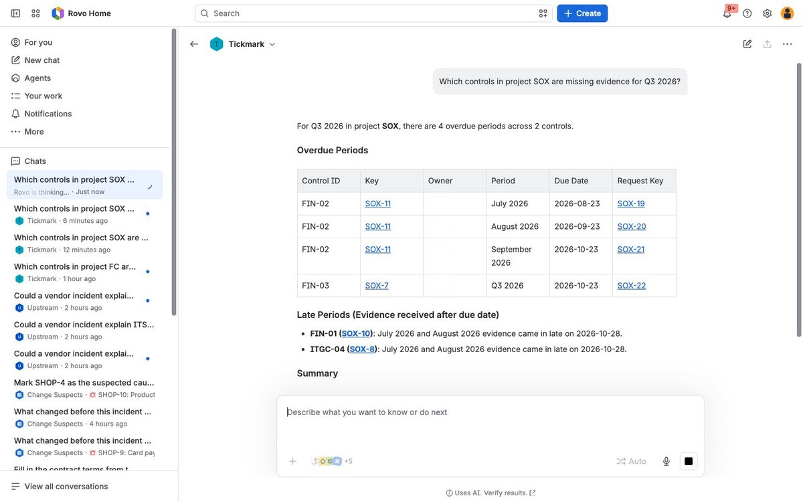

# Tickmark

Which controls are missing evidence this quarter? Tickmark tracks the evidence for SOX and other internal controls kept
as Jira work items: for each control and period, what came in, when, and what is still missing. It creates evidence
requests for control owners and gives Rovo the same view.

Built on Atlassian Forge for Codegeist 2026.

## What you get

- **Control evidence page** in every Jira project: pick a quarter and see each control's evidence for the periods that
  end in it (reviewed, in, came in late, requested, not requested, overdue or still running) with the files, their
  dates and the request work items, worst first. One button requests the evidence for every open period.
- **Control evidence panel** on a work item: set it up as a control (control ID, monthly, quarterly or yearly, the
  days after each period to provide evidence, the evidence needed, key control, first period to track). The panel then
  lists the recent periods with their status and a **Request evidence** button.
- **Evidence requests**: one work item per control and period, assigned to the control owner, due on the evidence due
  date, linked to the control and saying what is needed. Owners attach the files there; marking the request done
  records the evidence as reviewed.
- **Rovo agent "Tickmark"** with three actions, `evidence-status`, `control-evidence` and `request-evidence`.
  `request-evidence` is an UPDATE action, so Rovo asks the user to confirm before it creates a request. The app also
  exposes the actions as tools on the Atlassian MCP server, and [`skills/tickmark/SKILL.md`](skills/tickmark/SKILL.md)
  tells a third-party agent how to use them.
- **Load sample controls** creates eight controls of a fictional company, with evidence files and requests timed so
  that the last completed quarter shows every state.

## Screenshots







The screenshots show fictional sample data.

## How evidence is read

- Periods are calendar months, quarters and years in UTC. Evidence for a period is due a set number of days after it
  ends: 10 for monthly, 30 for quarterly and 45 for yearly controls unless the control says otherwise.
- Evidence is the files attached to the period's request work item, and files attached to the control whose names carry
  the period (2026-09, Sep 2026, Q3 2026, 2026Q3 or FY2026).
- A period with files is "Evidence in" when the first file came in by the due date and "Came in late" otherwise, and
  "Reviewed" when its request is done. Without files it is "Period running" until the period ends, then "Requested" or
  "Not requested" until the due date, then "Overdue". Periods before the control's first tracked period are left out.
- Tickmark records when evidence arrived and whether its request was closed. It does not judge whether a control
  works, whether the evidence is sufficient or what an auditor would conclude.

## Try it

1. Install the app on a Jira site.
2. Open a project (a business project works well), choose **Control evidence** in the project's navigation (it may
   sit under More) and press **Load sample controls**.
3. Open one of the controls and its **Control evidence** panel from the apps button under the title.

## Architecture

- `src/core/`: plain JavaScript, no network: `periods.js` (periods, due dates, period tokens in file names),
  `evidence.js` (status of each period and the quarter overview), `sample.js` (sample controls).
- `src/jira.js` (Jira REST as the current user) and `src/index.js` (resolvers and Rovo actions).
- `src/frontend/`: UI Kit project page and issue panel.
- Controls and requests are found with JQL on two indexed issue properties: `tickmark` (the control setup) and
  `tickmark-request` (the control and period a request is for).
- No storage outside Jira, no calls outside Atlassian and no LLM calls in the app. The Rovo agent uses Rovo's own model
  on the site that runs it.

## Development

```sh
npm install
npm test
forge lint
forge deploy -e development
forge install --site <your-site>.atlassian.net -p Jira -e development
```

## Credits

Built with help from an AI coding assistant (Anthropic Claude). The sample controls and evidence files are fictional.

## Licence

MIT.
